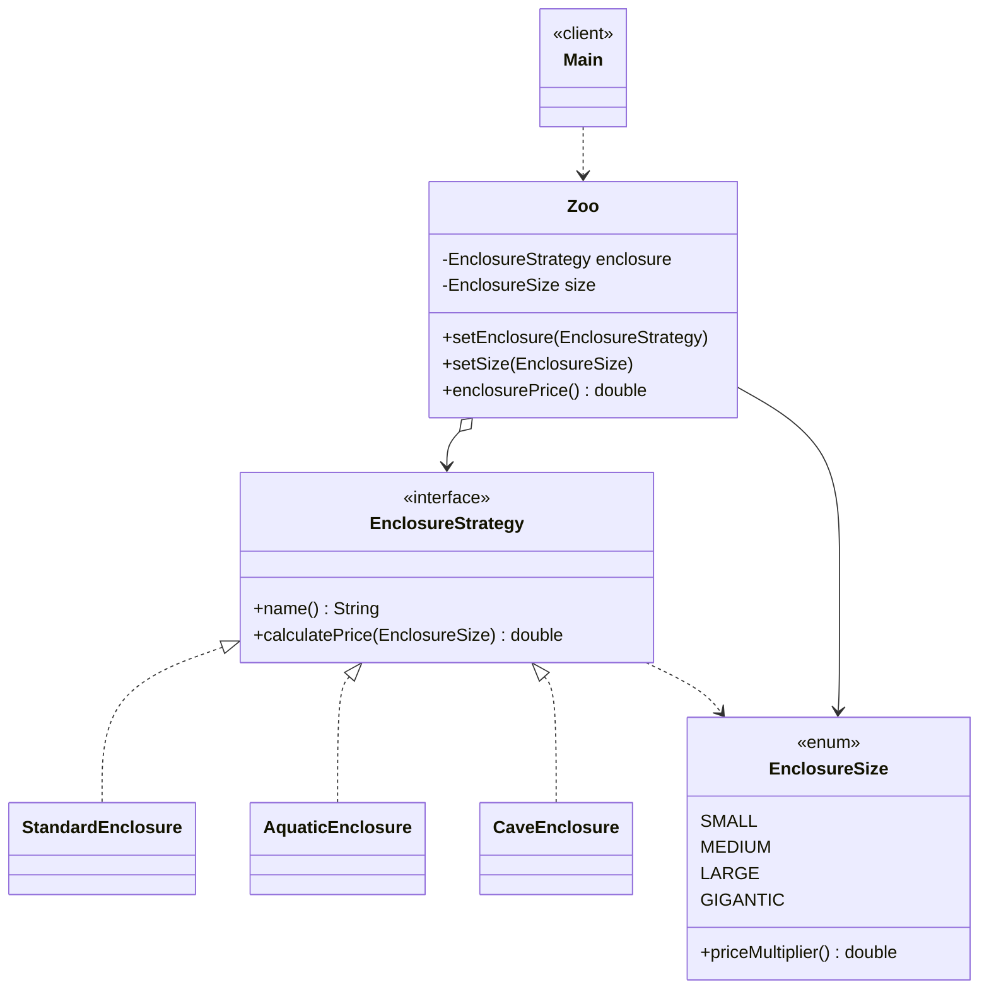

# Zoo Enclosures — Strategy Pattern (Assignment #5, Option C)

## 1. Introduction
Domain: pricing of zoo enclosures. The family of algorithms is the **way animals are kept**
(enclosure type): `Standard`, `Aquatic`, `Cave`. Each computes its price differently and can be
swapped while the program runs. **Size** (small / medium / large / gigantic) is *not* a strategy:
it is a configuration value (`EnclosureSize`) that only scales the final price.
`Zoo` does not know how a price is calculated — it just asks the current enclosure.

## 2. UML


## 3. Clean Code principles
1. **Polymorphism instead of conditionals.** Before: `if (type == WATER) {...} else if (type == CAVE) {...}`
   inside `Zoo`. After: `return enclosure.calculatePrice(size);` — no branching on type anywhere.
2. **Intention-revealing names.** `AquaticEnclosure`, `CaveEnclosure`, `WATER_FILTRATION`,
   `EXCAVATION`, `calculatePrice` say what they do; no `Type1`, no magic numbers.
3. **Single Responsibility.** Each strategy only knows the cost model of one enclosure type;
   `EnclosureSize` only knows its multiplier; `Zoo` only delegates.
4. **Context is algorithm-agnostic.** `Zoo` imports only the `EnclosureStrategy` interface, never a
   concrete class (see `Zoo.java`). Concrete strategies are chosen in the client (`Main`).
5. **Open/Closed — easy extensibility.** A new type (e.g. `AviaryEnclosure implements EnclosureStrategy`)
   is a new file; `Zoo`, `Main` logic and existing strategies are untouched.
6. **Size as data, not as a class hierarchy.** Modelling size as a strategy would multiply classes
   (3 × 4 = 12); an enum keeps it to 3 strategies + 4 constants.
7. **Small functions, no duplication of concerns.** Each method is 1–3 lines.

## 4. Conclusion
Cost: 1 interface + 3 classes. Gain: enclosure type is switchable at runtime, `Zoo` never changes
when a new type appears, and there is no `if/switch` on the type.

## 5. Repository
<!-- add your GitHub link here -->

## Run
```
javac -d out $(find src -name '*.java') && java -cp out zoo.Main
```
Sample output: `Cave enclosure, GIGANTIC: 82,000.00`
